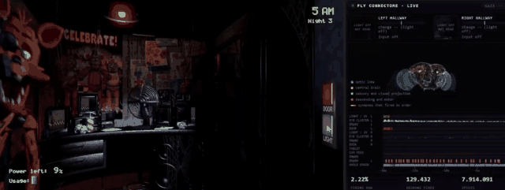
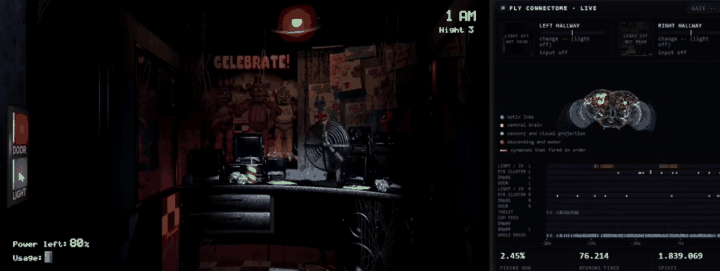
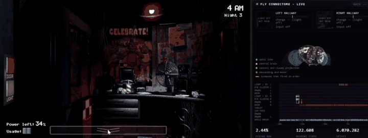

  

  
  
  
   
  <a href="#versão-em-português">Versão em português no fim da página</a>

Hi, I'm Artur. I study Software Engineering at the University of Brasília and I'm in my 8th semester. Most of what I build is AI or back-end work, and a lot of it ends up in healthcare, mostly because that's where I keep finding problems I care about.

Outside of class I'm part of the Samsung Ocean residency and PET-Saúde Digital, and in my free time I'm teaching a simulated fruit fly brain to play Five Nights at Freddy's.

## What I'm working on

At **Samsung Ocean**, my team built Diálise Digital for the hemodialysis center at the University Hospital of Brasília. The challenge we were given was an AI agent to standardize clinical notes using SNOMED CT. After spending time at the center, we saw that a lot of the hemodialysis routine wasn't covered by the hospital system at all, and the staff kept it on paper and a whiteboard. That seemed more urgent. We changed course and built an extension to the hospital system for monthly notes, alerts, prescriptions and reports, with an AI assistant included. Nephrology residents have already tested it. The code is private.

At **PET-Saúde Digital**, I'm building a web platform for dementia screening in primary care, with AI-assisted triage. This is also my undergraduate thesis.

At the university, I'm part of **MED**, a dementia screening project in partnership with UniEuro. Patients take drawing tests on a tablet and an AI model helps analyze the drawings. The app runs on the tablet and works fully offline.

## Fly-NAF

  

<table>
  <tr>
    <td width="50%"></td>
    <td width="50%"></td>
  </tr>
  <tr>
    <td align="center">Chica shows up at the window and the door closes</td>
    <td align="center">Foxy leaves the cove and the fly reacts</td>
  </tr>
</table>

[Fly-NAF](https://github.com/ArtyMend07/Fly-NAF) is my favorite personal project. It runs 138,639 neurons from the FlyWire connectome of the fruit fly, wired with the real synapses, and connects that brain to the game. The screen goes into the fly's visual neurons, and its descending neurons move the mouse. Nothing is trained. When the fly shuts a door on Chica, it's because a real escape circuit in its brain fired.

So far it has made it to 5 AM on night 3 with 9% power left ([video](https://www.youtube.com/watch?v=R4Ogbf33Gfo)). The project has ADRs, documented experiments and a test suite running on CI, and it's listed in [awesome-fly](https://github.com/cobanov/awesome-fly).

## Other projects

| Project | Description | My part |
|---|---|---|
| [Applied AI projects](https://github.com/ArtyMend07/applied-artificial-intelligence-projects) | Search, Minimax, genetic algorithms, Bayesian networks, particle filters, SAC and CNNs, each applied to a small simulated scenario | All of it |
| [Clinical monitoring on Kubernetes](https://github.com/lucasarruda9/k8s-pspd) | Microservices for clinical data with FHIR, gRPC and Keycloak | Infrastructure, monitoring and load tests |
| [Distributed DICOM pipeline](https://github.com/lucasarruda9/PSPD) | gRPC services in Go that anonymize and enhance medical images | Docker and Kubernetes setup |
| [EduInfra AI](https://github.com/daviegito/bd2_2026_2_eduinfra) | RAG assistant that answers questions about school infrastructure and ENEM results | Data pipeline, ADRs and delivery |
| [MED app](https://github.com/fga-eps-mds/2026.2-UNB-FCTE_UNIEURO_MED-APP) | Offline Android app for dementia screening | Sign-up, password hashing and patient visit records |
| [CIS IEEE challenges](https://github.com/ArtyMend07/cis-ieee) | ML pipelines tracked with MLflow, and a comparison between BM25 and FAISS for RAG | All of it |

Older university projects

 

- [Star Wars MUD](https://github.com/SBD1/2025.1-Star_Wars-11), a text RPG where most of the game logic lives in PostgreSQL triggers
- [PyLua](https://github.com/lucasarruda9/PyLua), a Python to Lua compiler
- [MidNight Warfare](https://github.com/EDAII/Grafos_MidNightWarfare_FNAF), [ShuffleWar](https://github.com/EDAII/Ordena_ShuffleWar), [Nemesis](https://github.com/EDAII/Busca_Nemesis) and the [Emotion Simulator](https://github.com/EDAII/ArvoreBalanceada_Simulador_Emocoes), small games built around graphs, sorting, search and red-black trees
- [RAG Context Packer](https://github.com/projeto-de-algoritmos-2026/G19_Programacao_Dinamica_PA-26.1), which uses the knapsack problem to pick context for RAG
- [Smash-Run](https://github.com/Maliz30/Smash-Run), an XR game in Unity
- [DF Public Spending](https://github.com/unb-mds/Gastos-DF-2024-02), charts of public spending in the Federal District
- [EDA1 tutoring](https://github.com/ArtyMend07/Monitoria_EDA1), material from when I was a Data Structures teaching assistant

## Tools

  
   
  

I'm comfortable working in Scrum teams, writing user stories and recording decisions in ADRs. Right now I'm trying to get better at software testing.

## Contributions

  

  <picture>
    <source media="(prefers-color-scheme: dark)" srcset="https://raw.githubusercontent.com/ArtyMend07/ArtyMend07/output/github-contribution-grid-snake-dark.svg"/>
    
  </picture>

If you want to talk about any of this, my email and LinkedIn are at the top. Thanks for reading.

---

Versão em português

 

Oi, eu sou o Artur. Estudo Engenharia de Software na Universidade de Brasília e estou no 8º semestre. Quase tudo que eu faço é IA ou back-end, e muita coisa acaba indo pra área da saúde, porque é onde eu mais encontro problemas que me interessam.

Fora das aulas, participo da residência da Samsung Ocean e do PET-Saúde Digital. No tempo livre, estou ensinando um cérebro simulado de mosca-das-frutas a jogar Five Nights at Freddy's.

### No que estou trabalhando

Na **Samsung Ocean**, minha equipe desenvolveu o Diálise Digital para o Centro de Hemodiálise do Hospital Universitário de Brasília. O desafio inicial era um agente de IA para padronizar as evoluções médicas usando SNOMED CT. Depois de acompanhar a rotina do centro, vimos que boa parte do trabalho da hemodiálise nem estava no AGHU, e a equipe controlava tudo em papel e quadro branco. Isso parecia mais urgente. Mudamos o escopo e construímos uma extensão do AGHU para evoluções mensais, alertas, prescrições e relatórios, com um assistente de IA. Residentes da Nefrologia já testaram. O código é privado.

No **PET-Saúde Digital**, estou desenvolvendo uma plataforma web de rastreamento de demência na atenção primária, com triagem apoiada por IA. Esse também é o meu TCC.

Na universidade, faço parte do **MED**, um projeto de rastreio de demência em parceria com a UniEuro. Os pacientes fazem testes de desenho num tablet e um modelo de IA ajuda a analisar os desenhos. O app roda no tablet e funciona totalmente offline.

### Fly-NAF

O [Fly-NAF](https://github.com/ArtyMend07/Fly-NAF) é o meu projeto pessoal favorito. Ele roda 138.639 neurônios do connectome FlyWire da mosca-das-frutas, ligados pelas sinapses reais, e conecta esse cérebro ao jogo. A tela entra nos neurônios visuais da mosca, e os neurônios descendentes mexem o mouse. Nada é treinado. Quando a mosca fecha a porta na cara da Chica, é porque um circuito de fuga de verdade disparou no cérebro dela.

Até agora ela chegou às 5 AM da noite 3 com 9% de energia ([vídeo](https://www.youtube.com/watch?v=R4Ogbf33Gfo)). O projeto tem ADRs, experimentos documentados e testes rodando em CI, e está listado no [awesome-fly](https://github.com/cobanov/awesome-fly).

### Outros projetos

| Projeto | Descrição | Minha parte |
|---|---|---|
| [Projetos de IA aplicada](https://github.com/ArtyMend07/applied-artificial-intelligence-projects) | Busca, Minimax, algoritmos genéticos, redes bayesianas, filtro de partículas, SAC e CNNs, cada um aplicado a um cenário simulado | Tudo |
| [Monitoramento clínico em Kubernetes](https://github.com/lucasarruda9/k8s-pspd) | Microsserviços de dados clínicos com FHIR, gRPC e Keycloak | Infraestrutura, monitoramento e testes de carga |
| [Pipeline distribuído de DICOM](https://github.com/lucasarruda9/PSPD) | Serviços gRPC em Go que anonimizam e realçam imagens médicas | Docker e Kubernetes |
| [EduInfra AI](https://github.com/daviegito/bd2_2026_2_eduinfra) | Assistente RAG que responde perguntas sobre infraestrutura escolar e ENEM | Pipeline de dados, ADRs e entregas |
| [App MED](https://github.com/fga-eps-mds/2026.2-UNB-FCTE_UNIEURO_MED-APP) | App Android offline para rastreio de demência | Cadastro, hash de senha e registro de atendimento |
| [Desafios CIS IEEE](https://github.com/ArtyMend07/cis-ieee) | Pipelines de ML com MLflow e comparação entre BM25 e FAISS para RAG | Tudo |

Trabalho bem em equipes com Scrum, escrevendo histórias de usuário e registrando decisões em ADRs. No momento, estou tentando melhorar em testes de software.

Se quiser conversar sobre qualquer coisa daqui, meu e-mail e LinkedIn estão no topo. Valeu por ler.

